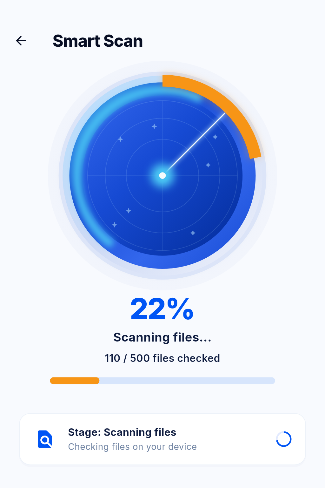

# Approved Smart Scan UI refinement

## Status and scope

Implemented against the supplied **Smart Scan Radar Progress(3).png** attachment (`/home/user/uploads/image-1.png`). No alternative artwork or generated image was substituted. The attached image remains the visual target.

**Not committed or pushed. Version remains `1.0.1+2`. No dependency changes are delivered.** The lockfile is unchanged from HEAD. Native sources, scan algorithms, stage contracts, detection/matching, permissions, deletion/authorization, calculations, signing, application ID, result navigation and existing operation timing gates were not modified.

## Final Flutter screenshot



[Open full-size 1024×1536 screenshot](approved-smart-scan-evidence/smart-scan-1024x1536.png)

This captures the production `ScanProgressScreen` with the production app theme and loaded Inter/Material icon fonts, at a **512×768 logical viewport, 2× capture ratio**. A held test repository supplies `110 / 500 files checked` through the existing `ScanOperation` pipeline; it is a reproducible widget capture, not a claim of scanning an Android device.

Android owns its normal status bar. The capture reserves a 24-logical-pixel top inset but does not fabricate OS clock, signal or battery glyphs. The current path is deliberately absent: the existing production snapshot does not expose a current path. A path slot is tested but no hard-coded example is supplied by production callers.

### Comparison and refinement performed

Actual Flutter captures were opened and compared with the supplied reference. Revisions brought the halo/radar center to approximately **(512, 553)** in the 1024×1536 capture, aligned the title/back arrow with the reference, enlarged the halo/rim, corrected a pale lower-right scanner rim to royal blue, lengthened the fine beam to the illuminated rim, strengthened the cyan central glow and tightened the bottom card.

The layout now has only the requested hierarchy: native status-bar region, back/title, dominant radar, external percentage, actual activity, optional actual path, one processed-work counter, separate thin progress bar and compact stage card. The introductory title/subtitle, privacy pill and redundant approval reassurance were removed from this scanning screen.

The screenshot is a vector/layout reconstruction, not a promise of pixel-identical rasterization across devices. The supplied illustrative image's filled pixels are not used as a progress estimate: **22% means a 79.2° orange sweep and exactly 22% of the bar's available width**, with both bound to the same measured data.

## Files added or modified

### Production UI

- **Added** `lib/core/ui/smart_scan_progress.dart` — responsive shared radar presentation, below-circle percentage/activity/counter, optional real path, measured bar and compact stage card.
- `lib/core/ui/circular_file_scanner.dart` — optional presentation builder exposing the existing animated fill and motion; no second count-up controller. Standalone/cleaning callers retain their existing path.
- `lib/core/ui/reference_progress_art.dart` — scanning-only approved proportions, concentric grid/crosshair, sparkles, cyan lip/glow and fine rotating beam. Cleaning branches retain their approved values.
- `lib/features/cleaner/presentation/screens/scan_progress_screen.dart` — approved screen hierarchy, title spacing and actual stage information; existing error/retry/back behavior retained.
- `lib/features/files/presentation/widgets/photo_tool_ui.dart` — replaces the 92-logical-pixel loading radar with the same responsive presentation while retaining each module's own activity/description and selected-stage data. Cached terminal scans still cannot replay a success check in a loading view.

### Tests and delivery evidence

- **Added** `test/approved_smart_scan_ui_test.dart` — 21 new checks including actual-screen captures, responsive route layouts and byte-identical broom protection.
- Updated `test/circular_file_scanner_test.dart`, `test/stage_scan_progress_test.dart`, `test/widget_test.dart` for the requested spinner, separated counter/stage label and removal of the old introductory headings.
- This report plus `docs/approved-smart-scan-evidence/`: final screenshot, full-suite/analyzer output and machine-readable verification metadata.

## Diameter and responsive rules

The layout computes, in logical pixels:

```text
W = min(available width, 960)
s = clamp(W / 512, 0.625, 1.3)
t = max(1, effective text scale at 16)
H = available body height
D = min(0.72 × W, max(120, H − 290 × s × t))
```

When height is unbounded, the loading presentation uses 80% of the media height as its layout budget. The artwork stays square, centered and width-bounded. A single **vertical** scroll surface handles unusually short windows or enlarged text; no horizontal scroll is introduced and the radar is not clipped to fit the screen.

At the reference viewport, **D = 368.64 logical pixels / 737.28 capture pixels**, versus the old 228-pixel Smart Scan radar and 92-pixel module loading radar. The visible soft halo radius is `.49 × D`; the blue center radius is `.342 × D`; illuminated rim `.398 × D`; orange arc center radius `.405 × D` with `.05 × D` stroke. The arc begins at 12 o'clock and advances clockwise.

Content side padding is `0.0586 × W`. The progress bar spans approximately 69% of W, uses rounded ends, and has `11 × s` logical-pixel height. Type scales with width: percentage `46 × s` (bold), activity `19 × s`, counter and stage title `16 × s`, supporting line `14 × s`. Existing Inter fonts are reused. The card has an `18 × s` corner radius, hairline border and restrained shadow. Large-screen content is capped rather than stretched edge to edge.

Tested layout sizes include **320×568, 360×640, 512×768, 800×1280 and 640×360**, plus compact 2× text scaling. Actual `ScanProgressScreen` route layouts, including the app bar, are additionally tested at 320×568 and 800×1280.

## Exact reference palette

All nine existing constants remain exact and are unit-tested:

| Token | Hex |
|---|---|
| Royal blue | `#3367ED` |
| Blue | `#164AD3` |
| Deep blue | `#032C99` |
| Cyan | `#49C4F3` |
| Ice blue | `#B4DFFE` |
| Pale ring | `#CEDAF5` |
| Outer halo | `#EFF2FB` |
| Orange | `#F79516` |
| White | `#F4FBFC` |

The approved vivid blue for external percentage and stage icon/spinner accents is `#0055F5`; the pale bar track is `#D7E5FC`. These surrounding UI accents do not replace the sampled radar palette.

## Percentage and progress binding

- The selected `displayStage` supplies processed work, reliable total, unit, stage identity and fraction. The fallback snapshot fields are used only when there is no selected stage; unrelated parent counters are not mixed into a child stage.
- The existing `CircularFileScanner` confirmed-fill controller is the **single presentation source** for the radar's orange sweep, external percentage and horizontal fill. The surrounding presentation receives the actual animation value rather than starting a separate implicit animation.
- Smooth interpolation lasts up to the existing 240 ms using confirmed target values only. It never overshoots confirmed work and does not keep advancing when work stalls. The displayed integer is `floor(animatedFill × 100)`.
- The counter appears once, with the actual selected-stage units. No planned-work multiplication, hard-coded path or timer-generated percentage is introduced.
- Unknown totals hide the number and orange measured fill. Actual processed counts remain visible, and the beam/small stage activity mark communicate activity. A zero denominator remains unknown until the existing contract reports actual empty-stage completion.
- A changed scan or stage identity resets the fill. Stage 100% does not display the parent success check. The existing parent success/completion transition remains the only checkmark authority.
- Beam rotation remains continuous while active and independent of progress. The small card spinner is a determinate arc rotated by that **same lifecycle-controlled motion animation**, not a new perpetual animation controller. Background, inactive, reduced-motion and ticker visibility behavior therefore remains shared. No sound was added.
- `ScanStagePresentation` continues to coalesce visual stage boundaries atomically; it does not invent work.

## Cleaning preservation

The broom presentation, deletion UI, accounting and authorization code were not changed. All cleaning painter values remain on their original branch. A new regression test renders the approved broom component and checks its complete PNG bytes against the previously approved capture:

```text
SHA-256 cb666b879c21d18186ba5029d7ccb90e99f03708dc593cb7a3b923e23b4b3f23
```

The new render is **byte-for-byte identical**. Existing cleaning and deletion tests also pass in the full suite.

## Final verification

Environment: Flutter **3.50.0 stable**, Dart **3.14.0**, Linux.

| Check | Result |
|---|---|
| Complete Flutter suite | **834 passed** |
| New approved-UI checks | **21 passed** as part of the complete suite |
| Flutter analysis | **0 errors, 1 warning, 112 informational findings** |
| Analyzer exit code | **1** — not a clean analyzer run |
| Remaining warning | Existing missing `assets/icons/` directory declared in `pubspec.yaml` |
| Informational findings | Existing SDK Material-import deprecations/style findings, plus Material imports in the two new files |
| `git diff --check` | Passed |
| Lockfile/version | Lockfile unchanged; `1.0.1+2` unchanged |
| Native/permission/deletion/signing changes | None |
| Commit/push | Neither performed |

Commands:

```sh
flutter test --no-pub --concurrency=1 --reporter expanded
flutter analyze --no-pub
git diff --check
```

Flutter's SDK-pinned transitive dev resolution was used locally for verification; the repository lockfile was restored unchanged and no dependency upgrade is part of delivery.

Evidence: [full test output](approved-smart-scan-evidence/full-flutter-tests.txt), [analysis output](approved-smart-scan-evidence/flutter-analysis.txt), [verification metadata](approved-smart-scan-evidence/verification.json).

## Remaining device testing

No Android device/emulator was available, so this delivery does not claim device-rendered screenshots, frame-rate profiling or an installed release build. No new APK/AAB build was attempted for this UI-only refinement; the previous environment lacked a complete Android SDK.

Before release, verify real Android status/navigation-bar insets, font rasterization and text scaling; compact portrait and landscape; dark theme; long actual stage names; beam smoothness on lower-end hardware; back/cancel/retry; background/resume/activity recreation; reduced motion; real stage transitions and final parent completion. Visually approve the installed screen against the attached reference. Recheck the separately approved cleaning screen on-device without changing its design.
